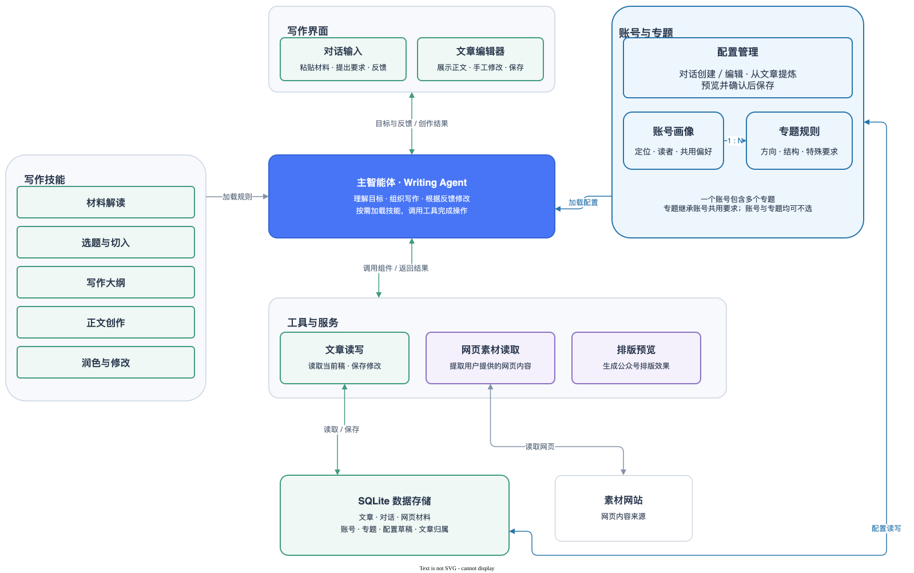

# We-Article

<p align="center">
  
</p>


We-Article 是一个 AI 写作工作台。从想法或材料出发，你可以与 AI 讨论、起草和修改文章，写作方向与最终内容由你决定。

## 关于 We-Article 的定位

我了解过很多 AIGC 工具，最后的感觉是：**没有一劳永逸**的东西，不可能靠某个工具就稳定产出高质量的内容。

基于这个判断，We-Article 不是一个可以**无脑**生成文章的工具。使用者需要带着账号的定位、自己的判断和审美品味，与 AI 协作完成文章。

你可以把账号定位、读者和写作要求整理成配置，也可以从已有文章中提炼专题，让后续写作有可参考的方向。每篇文章仍需要你结合材料、修改正文，并对内容负责。

## 能做什么

- **讨论与写作**：解读材料，讨论选题和大纲，起草正文，按照反馈修改。
- **编辑与保存**：在对话旁直接修改文章，保存正文和对话，随时打开继续写。
- **记住写作要求**：通过对话建立账号和专题，记录读者、内容方向和写作要求；也可以从已有文章提炼专题。不设置也能直接写作。
- **排版与复制**：预览不同排版风格，复制到公众号编辑器，继续处理标题和配图。

## 开始使用

1. 安装 Node.js 22.12 或更高版本，然后安装依赖并创建配置文件：

   ```bash
   npm install
   cp .env.example .env
   ```

2. 打开 `.env`，填写 `MODEL_API_KEY`，并根据模型服务设置 `MODEL_PROVIDER`、`MODEL_BASE_URL` 和 `MODEL`。模型需要支持工具调用。其他配置见 `.env.example`。

3. 运行 `npm run dev`，打开 [http://127.0.0.1:3200](http://127.0.0.1:3200)。在对话框输入想法、材料或网页链接，即可开始写作。点击「保存」保存正文，点击「文章」查看已有文章。

4. 文章、对话和写作配置保存在 `data/we-article.db`。建议定期备份数据库及其 SQLite 关联文件；不要提交 `data/` 和包含密钥的 `.env`。

工作台无需登录，默认监听所有网络接口。能访问服务的人可以读写文章和配置，请在可信网络中使用或限制访问。可选的 LangSmith 追踪开启后会上传写作内容和工具数据。

## 系统架构



- **写作界面**：对话与文章编辑并行，用户随时调整方向和正文。
- **写作智能体与技能**：智能体根据本篇要求和账号、专题配置，按需读取写作技能，组织材料解读、选题、大纲和正文修改。
- **工具与服务**：写作智能体可以读取网页素材和当前文章、更新候选稿；排版服务单独生成预览。
- **数据存储**：文章、对话、账号和专题配置保存在本地 SQLite 数据库；配置由用户确认后保存。

## 许可

We-Article 代码采用 [MIT 许可](./LICENSE)，允许使用、修改、商用和闭源分发，无需另行授权；须按许可条款保留版权与许可声明。

第三方依赖及字体、图标等素材遵循各自的许可，不因本项目采用 MIT 而改变。

Copyright (c) 2026 HongQun [hongqun.hq@gmail.com](mailto:hongqun.hq@gmail.com)
