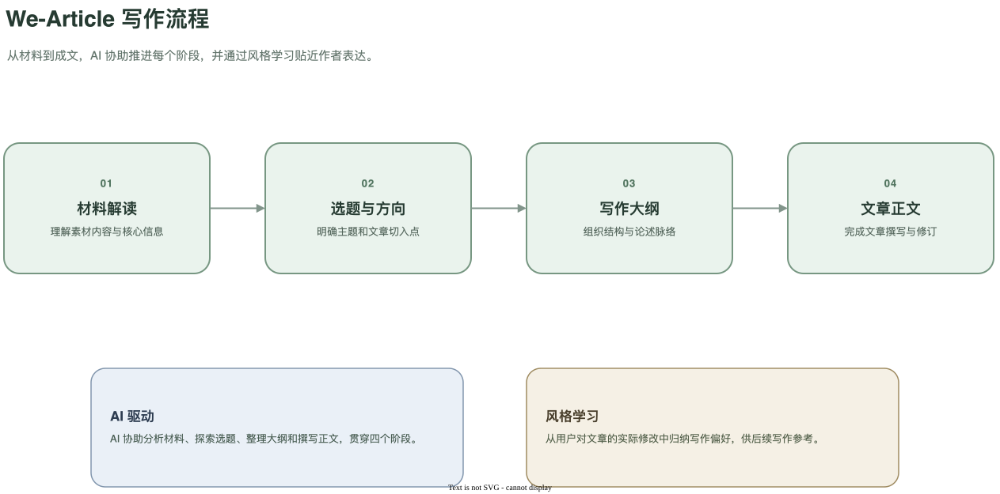

# We-Article

<p align="center">
  
</p>

We-Article 是一个微信公众号文章生成工作台。它把写作分成四个阶段：材料解读、选题与方向、写作大纲、文章正文。


生成的文章支持一键排版并推送到公众号草稿箱。

文章专题通过 JSON 和 Markdown 文件配置。

## 系统架构




文章的生成过程分成四个阶段，每个阶段由一个Agent负责：

1. 材料解读：当你发现有趣的话题时，可以把内容或网址贴进来，让Agent对材料进行解读，并寻找与你的账号定位的潜在关联。
2. 选题与方向：在这个阶段，Agent会给出5个标题供你选择。并简要说明写作方向。
3. 写作大纲：根据确定的标题和写作方向，给出文章的组织结构和论述脉络。
4. 文章正文：Agent根据写作大纲，参考原始材料，写出正文。

整个过程由AI驱动，目前接入的是Deepseek。

工作流支持**风格学习**引擎，在文章生成的过程中，可以手工介入进行修改。系统会自动记录并总结个人的风格偏好，并反馈给Agent。经过一段时间后，就可以形成稳定的个人风格。

同时，工作流支持公众号自动排版和一键推送到草稿箱的功能。


## 关于We-Article的定位

我了解过很多AIGC的工具，但最后的感觉是：**没有一劳永逸**的东西，不可能靠某个工具就能稳定产出相对高质量的内容。

基于这个基本的判断，We-Article并不是那种可以**无脑**生成文章的工具，使用者要带着账号的定位、自己的判断和审美品味，与AI协作来产出文章。

在文章的生成过程中，We-Article会不断学习你的风格、你的账号的特点，慢慢的你的手工介入的次数就会越来越少，你的文章质量会越来越稳定。

如何判断文章的质量呢？其实就是从阅读量上入手。所以We-Article支持**文章统计**功能，可以获取公众号后面的相关数据，这些数据后续也可以和风格学习自动产生关联，让风格学习更加灵敏。

## 快速开始

需要 Node.js 22.12 或更高版本（建议 Node.js 24）。

```bash
npm install
cp .env.example .env
```

在 `.env` 中填写 `DEEPSEEK_API_KEY`。首次部署还应设置 `APP_PASSWORD` 和随机生成的 `SESSION_SECRET`。然后启动：

```bash
npm run dev
```

访问 [http://127.0.0.1:3200](http://127.0.0.1:3200)。

## 数据与密钥

- `data/article.sqlite`：文章项目、对话、正文版本、成稿、风格记忆和公众号统计。
- `data/local/topics/`：本地新增或覆盖的专题，包括私人提示词、参考文章和配图模板。
- `data/wechat-covers/`、登录失败记录及 SQLite 临时文件。
- `.env`：模型、登录和公众号凭据。

不要把 `.env`、`data/`、参考文章或封面加入提交。示例文件中不应填写真实密钥、账号 ID 或素材 ID。

公众号发布和统计通过专题 ID 查找 `.env` 变量。将专题 ID 中的连字符换成下划线并转为大写，例如 `my-topic` 使用 `WECHAT_MY_TOPIC_*`：

```dotenv
WECHAT_MY_TOPIC_APP_ID=
WECHAT_MY_TOPIC_APP_SECRET=
WECHAT_MY_TOPIC_DEFAULT_THUMB_MEDIA_ID=
WECHAT_MY_TOPIC_AUTHOR=
WECHAT_MY_TOPIC_NEED_OPEN_COMMENT=true
WECHAT_MY_TOPIC_ONLY_FANS_CAN_COMMENT=false
```

公众号配置缺失时，该专题仍可正常写作，只是不显示发布和文章统计入口。默认封面必须是该公众号账号下可用的永久素材 ID。

## 专题配置指引

`topics/` 中的见隙和 Tech123 是公开示例。每个专题使用一个目录，目录名是项目保存的专题 ID，只能由小写英文字母、数字和连字符组成，并以小写字母开头。

公开示例中的规则和阶段提示词是便于起步的简化模板。

### 新增或覆盖专题

1. 在 `data/local/topics/` 下新建目录，或复制一个公开示例作为起点：

   ```bash
   cp -R topics/tech123 data/local/topics/my-topic
   ```
2. 编辑 `data/local/topics/my-topic/topic.json`，将展示名称、读者、结构和可选能力改为自己的设置。
3. 编辑 `rules.md` 和 `prompts/analysis.md`、`topics.md`、`outline.md`、`article.md`。
4. 保存后刷新页面。若本地专题 ID 与 `topics/` 中的示例相同，本地目录会覆盖示例；不同 ID 则作为新专题加入列表。

专题目录至少需要以下文件：

```text
data/local/topics/my-topic/
├── topic.json
├── rules.md
└── prompts/
    ├── analysis.md
    ├── topics.md
    ├── outline.md
    └── article.md
```

一个最小 `topic.json` 示例：

```json
{
  "name": "我的专题",
  "description": "专题定位和写作边界",
  "audience": "目标读者",
  "outlineLabel": "写作大纲",
  "directionLabel": "说明本篇要回答的问题",
  "structure": "正文结构要求",
  "default": false,
  "workflow": "staged",
  "styleMemory": false
}
```

常用字段：

| 字段                                    | 说明                                                                    |
| --------------------------------------- | ----------------------------------------------------------------------- |
| `name`、`description`、`audience` | 专题名称、定位和读者，会进入写作上下文                                  |
| `outlineLabel`、`directionLabel`    | 页面中大纲和方向区域的名称                                              |
| `structure`                           | 正文结构要求，会提供给生成与成稿检查                                    |
| `default`                             | 将专题设为新文章默认项；最多一个专题设为`true`                        |
| `workflow`                            | 阶段流程，省略时默认为`staged`                                        |
| `directionLength`                     | 可选方向字数提示，例如`{ "min": 40, "max": 80 }`                      |
| `paragraphLength`                     | 可选正文每段字数提示；只用于提示，不截断正文                            |
| `styleMemory`                         | `true` 时按专题隔离保存真实修改证据和写作画像                         |
| `writingSkill`                        | 可选值`human-writing`，启用本地正文写作技能                           |
| `referencesFile`                      | 可选的参考文章文件名；建议只放在`data/local/topics/<id>/`             |
| `imagePromptFile`                     | 可选配图模板文件名；正文占位符`[在此输入文章内容]` 必须且只能出现一次 |

规则和提示词在下次模型请求时读取。参考文章只作为写作参考，不作为新文章事实来源。专题配置无效、提示词缺失或 JSON 格式错误时，服务端会返回配置错误；请检查 ID、文件路径和 JSON 语法。

每个专题共享同一套写作流程和本地文章数据库。模型凭据、公众号账号、文章、用户修改、风格画像和参考范文不需要写入代码，也不应放进公开示例。
